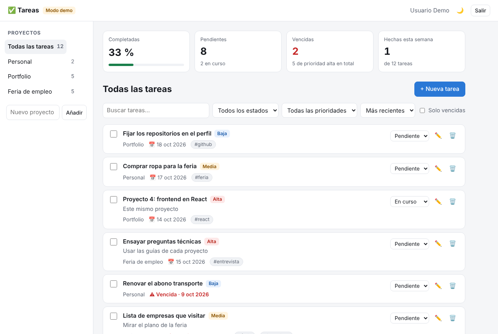
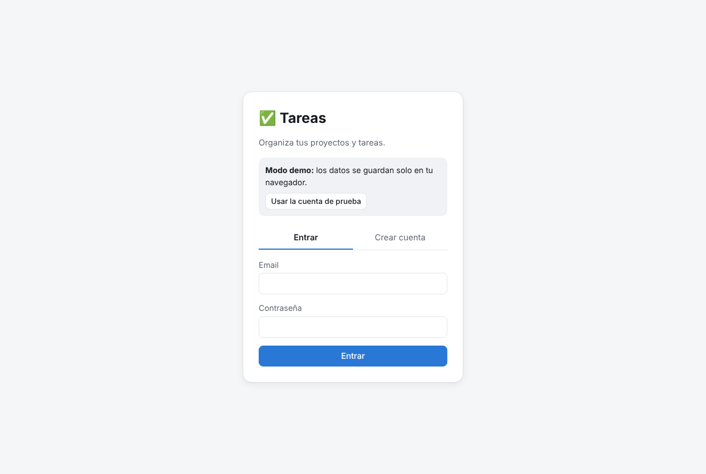
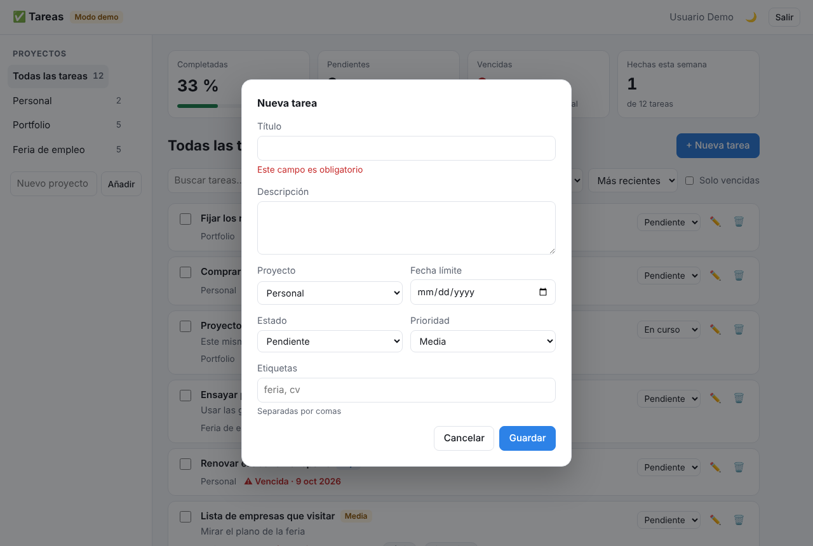
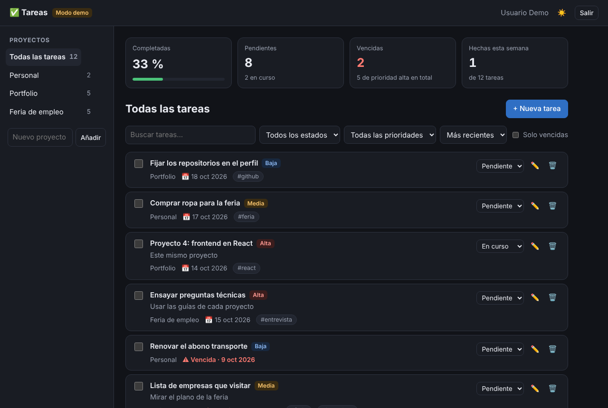
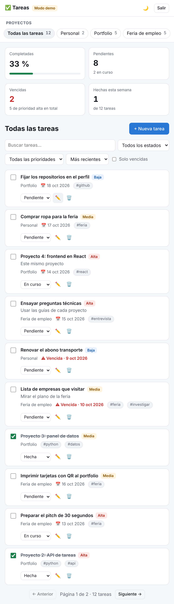

# ✅ Tareas · frontend en React

Aplicación web para gestionar proyectos y tareas, hecha con **React, TypeScript y Vite**. Es el frontend de la [API de Tareas](https://github.com/munguiagomezj/Proyecto2) (Proyecto 2, FastAPI).

**🔗 Demo en vivo:** https://munguiagomezj.github.io/Proyecto4/ · pulsa *«Usar la cuenta de prueba»*.



<details>
<summary>Ver inicio de sesión, formulario, modo oscuro y móvil</summary>

| Inicio de sesión | Nueva tarea (con validación) |
|---|---|
|  |  |

| Modo oscuro | Móvil |
|---|---|
|  |  |

</details>

## ✨ Funcionalidades

- **Registro e inicio de sesión** con token JWT. La sesión se mantiene al recargar y se cierra sola si el token caduca.
- **Proyectos**: crear, borrar y ver el número de tareas de cada uno.
- **Tareas**: crear, editar, borrar y completar, con prioridad, fecha límite, etiquetas y descripción.
- **Filtros** por estado, prioridad, etiqueta, vencidas y texto, con **orden** y **paginación**. Todo va en la URL, así que una vista filtrada se puede compartir o recargar.
- **Estadísticas** de progreso, pendientes, vencidas y completadas en la última semana.
- **Errores de validación de la API** mostrados junto a cada campo.
- Modo claro/oscuro, diseño responsive y formularios accesibles (etiquetas, `aria-invalid`, `aria-describedby`, foco visible).

## 🧪 Dos modos: demo y API real

GitHub Pages solo sirve archivos estáticos y no puede ejecutar el backend en Python. Por eso la app tiene dos implementaciones de la misma interfaz `ApiClient`:

| Modo | Cuándo | Cómo funciona |
|---|---|---|
| **Demo** | Sin `VITE_API_URL` (así se publica en Pages) | `src/api/mock.ts` simula la API en el navegador: validación, permisos, filtros, orden, paginación y estadísticas, con los datos en `localStorage` |
| **API real** | `VITE_API_URL=http://localhost:8000` | `src/api/http.ts` llama a la API de FastAPI con `fetch` |

El resto de la app no sabe qué cliente está usando. Los **tests end-to-end** comprueban el modo real: en CI se descarga y arranca la API del Proyecto 2 y Playwright prueba la app completa contra ella.

## 🧱 Arquitectura

```
src/
├── api/
│   ├── types.ts      # Tipos de la API + interfaz ApiClient + ApiError
│   ├── http.ts       # Cliente real (fetch, token, errores 422 de FastAPI por campo)
│   ├── mock.ts       # Cliente simulado para el modo demo
│   ├── queries.ts    # Hooks de TanStack Query (caché, invalidación, actualización optimista)
│   └── index.ts      # Elige el cliente según VITE_API_URL
├── auth/             # Contexto de sesión (token en localStorage, cierre por 401)
├── components/       # Sidebar, FiltersBar, TaskItem, TaskDialog, StatsBar, Field…
├── pages/            # LoginPage, DashboardPage
└── filters.ts        # Filtros ⇄ parámetros de la URL
e2e/                  # Playwright contra la API real
```

Decisiones técnicas:

- **TanStack Query** gestiona la caché del servidor: cada consulta tiene su clave, y tras crear o editar se invalidan las listas, los contadores y las estadísticas.
- **Actualización optimista** al completar una tarea: la casilla cambia al instante y, si la API falla, se deshace.
- **El estado de los filtros vive en la URL** (`?status=todo&tag=cv`), no en `useState`: se comparte, se recarga y funciona el botón Atrás.
- **Búsqueda con *debounce*** de 300 ms para no lanzar una petición por cada tecla.
- **HashRouter**, porque GitHub Pages no puede redirigir las rutas a `index.html`.
- **Inyección de dependencias**: `<App api={...}>` recibe el cliente, así los tests usan la API simulada sin tocar la red.

## 🚀 Ejecutar en local

```bash
npm install
npm run dev                                   # modo demo
VITE_API_URL=http://localhost:8000 npm run dev  # contra la API del Proyecto 2
```

Para usar la API real, arráncala desde el [Proyecto 2](https://github.com/munguiagomezj/Proyecto2) permitiendo el origen del frontend: `CORS_ORIGINS='["http://localhost:5173"]'`.

## ✅ Tests y calidad

```bash
npm test            # 24 tests con Vitest y Testing Library
npm run lint        # oxlint
npm run typecheck   # TypeScript estricto
npm run test:e2e    # Playwright (necesita la API en http://localhost:8000)
```

Los tests de componentes usan los roles y nombres accesibles (`getByRole`, `getByLabelText`), igual que un lector de pantalla. Si un campo no está bien etiquetado, el test falla.

En GitHub Actions, `CI` pasa lint, tipos, tests y build, y ejecuta los tests end-to-end contra la API real. `Publicar en GitHub Pages` despliega la demo en cada push a `main`.

## 📄 Licencia

[MIT](LICENSE)
